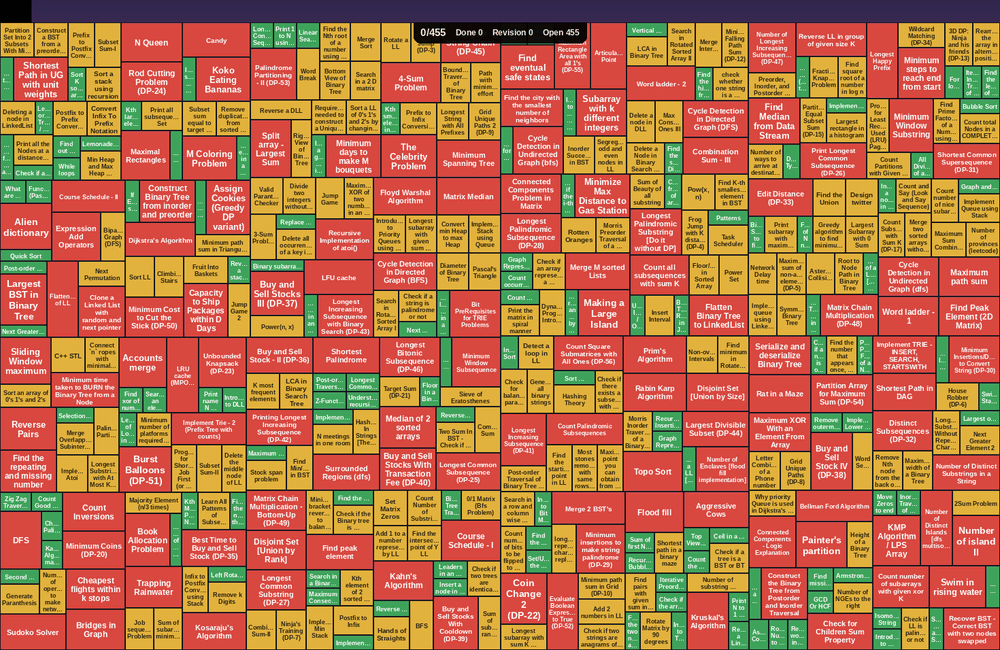

# dsa-wallpaper

**Turn your DSA problem sheet into a heatmap that covers your Mac desktop.
Every problem you solve knocks out a tile and reveals the wallpaper behind it.**



Every problem on your sheet is a tile:

| Tile | Meaning |
|---|---|
| 🟥 **Large, red** | Hard, not solved yet |
| 🟨 **Medium, yellow** | Medium, not solved yet |
| 🟩 **Small, green** | Easy, not solved yet |
| ▫️ **50% transparent** | Solved, but marked 📌 for revision |
| *(gone)* | Solved, or marked ❌ to skip |

- **Live:** reads your sheet from a GitHub repo (or a local file) and updates the desktop when it changes.
- **Works over video wallpapers** (e.g. WallSpace). Solved tiles are holes the video plays through.
- **Scattered, fixed layout:** tiles are randomly mixed (not grouped by topic) and never move, so the picture fills in like a scratch card.
- **Fits your screen exactly:** it measures your display's resolution, Retina scale and menu bar.
- **Progress pill** under the notch: `Total 349/455  🟢 127/131  🟡 149/188  🔴 73/136` (solved / total, overall and per difficulty).
- **Starts at login** and stays out of the way: no Dock icon, and clicks pass straight through.

## Requirements

- macOS (Apple Silicon or Intel)
- Xcode Command Line Tools, which provide Python 3 and `swiftc`:
  ```bash
  xcode-select --install
  ```

## Install

```bash
git clone https://github.com/imsoumya18/dsa-wallpaper.git
cd dsa-wallpaper
./install.sh
```

The first run creates `config.json`. Set `sheet_path` to your sheet's GitHub link (or a local file path), then run `./install.sh` again.

## Your sheet

Any markdown file with tables like this, either in a GitHub repo or on your Mac:

| # | Problem | Difficulty | ✅ Solved | 📌 Revision |
|:---:|:--------|:----------:|:---------:|:-----------:|
| `3.2.5` | Print subarray with maximum subarray sum | 🟡 | ✅ | |
| `5.2.6` | Longest Palindromic Substring | 🔴 | ✅ | ✅ |
| `15.5.5` | Kruskal's Algorithm | 🔴 | | |
| `1.3.2` | Java Collections | 🟢 | ❌ | |

- **Id:** the first column, in backticks. A problem can appear in several rows (for example a "new" week and a "revision" week); its marks are combined.
- **Difficulty:** 🟢 easy, 🟡 medium, 🔴 hard.
- **Solved** (second-to-last column): ✅ solved, or ❌ to skip the problem.
- **Revision** (last column): ✅ or 📌.

## Usage

It runs on its own: it starts at login and redraws whenever the sheet changes. A GitHub sheet is checked every few minutes, so push your changes and the desktop catches up. A local sheet updates as soon as you save.

| Command | What it does |
|---|---|
| `./stop.sh` | Hide the tiles and pause until next login |
| `./start.sh` | Resume right away |
| `./uninstall.sh` | Remove completely, so it no longer starts at login |
| `.venv/bin/python dsa_wallpaper.py` | Redraw now |
| `.venv/bin/python dsa_wallpaper.py --reshuffle` | New random layout |
| `.venv/bin/python dsa_wallpaper.py --simulate unsolved` | Preview with nothing solved (next save restores) |
| `.venv/bin/python dsa_wallpaper.py --preview out.png` | Render to a file only |

## Configuration

Edit `config.json` and save. Changes apply automatically.

| Key | Default | Description |
|---|---|---|
| `sheet_path` | | GitHub link (`https://github.com/<user>/<repo>/blob/main/README.md`) or local path to your sheet |
| `poll_minutes` | `3` | How often a GitHub sheet is checked |
| `mode` | `overlay` | `overlay` floats above any wallpaper; `wallpaper` bakes the tiles into a still photo |
| `photo_path` | `photo.jpg` | `wallpaper` mode only: the image to uncover |
| `weights` | `1 · 2 · 4` | Tile area for easy · medium · hard |
| `colors` | green · yellow · red | Hex color per difficulty |
| `revision_opacity` | `0.5` | Opacity of solved-but-revise tiles |
| `legend_position` | `notch` | `notch` (top center) or `bottom-right` |
| `labels`, `legend` | `true` | Show problem names / the progress pill |
| `seed` | `42` | Layout seed (`--reshuffle` changes it) |
| `resolution` | `auto` | Force a size such as `"2940x1912"` |
| `overlay_level_offset` | `-1` | Window layer relative to desktop icons. Use `1` if a wallpaper app still draws on top |

## How it works

```
GitHub / sheet.md ──▶ launchd agent ──▶ dsa_wallpaper.py ──▶ out/overlay.png
                                                              │
                         overlay/Overlay.swift ◀──reloads─────┘
                         (transparent, click-through window
                          between the wallpaper and desktop icons)
```

- **`dsa_wallpaper.py`** fetches the sheet (GitHub API, keeping a cached copy for when you're offline), parses it, lays the tiles out (seeded shuffle, then a recursive split of the screen weighted by difficulty), and draws them with Pillow.
- **`overlay/Overlay.swift`** is a small AppKit app that shows that image on every Space and display. It also writes `out/screen.json` with the real screen geometry, which the renderer uses.
- **`install.sh`** creates a Python venv, compiles the overlay, and registers two launchd agents: one renders when the sheet changes (polling GitHub, or watching the local file), the other keeps the overlay running.

Logs: `out/log.txt` (renderer) and `out/overlay-log.txt` (overlay).

## Troubleshooting

- **No tiles visible:** a wallpaper app may be drawing above the overlay. Set `"overlay_level_offset": 1` and run `./install.sh`.
- **Desktop widgets** always sit above the tiles and cover the ones underneath.
- **`wallpaper` mode:** keep the photo inside the repo folder. Background jobs can't read `~/Desktop`, `~/Documents` or `~/Downloads` without extra macOS permissions.
